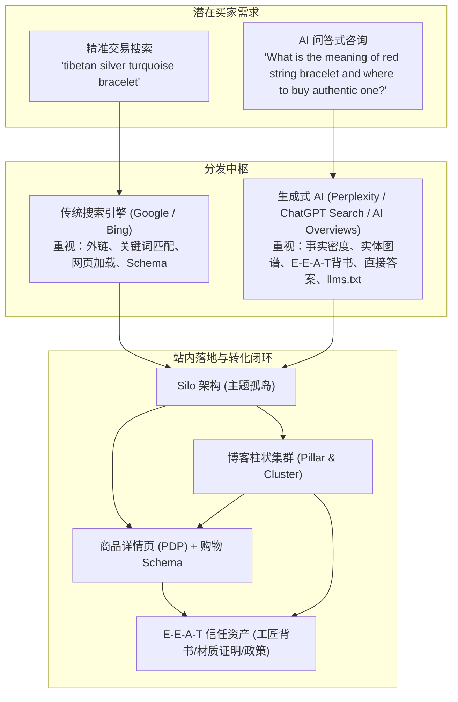
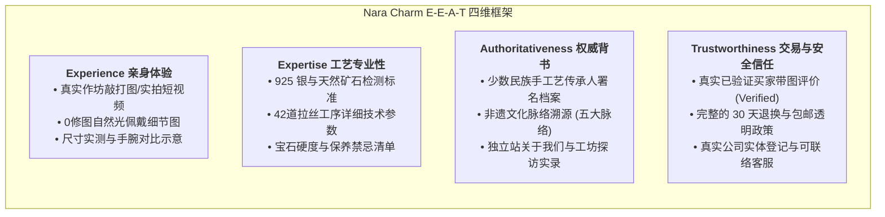

# Nara Charm · SEO & GEO 全维度优化白皮书与落地指南

> **适用站点**：Nara Charm 手工民族融合首饰跨境独立站 (`naracharm.com`)  
> **核心目标**：构建“传统搜索引擎 (Google/Bing)”与“生成式 AI 引擎 (ChatGPT / Perplexity / Google Gemini & AI Overviews)”双引擎获客飞轮。

---

## 一、 战略总览：SEO + GEO 双轮驱动模型

在跨境电商环境中，搜索获客已经演变为两套并行的认知逻辑：



- **SEO (Search Engine Optimization)**：负责占领高意图**搜索结果页（SERP）**，通过精准长尾词、静态极速加载（LCP/INP）和购物富媒体（Rich Results）获取精准点击。
- **GEO (Generative Engine Optimization)**：负责成为大语言模型（LLM）的**权威可信数据源（Citation Source）**，通过事实密集型段落、对比表格、实体图谱和权威背书，让 AI 在回答“送礼推荐”、“民族工艺科普”、“手饰叠戴”时优先引用并推荐 Nara Charm。

---

## 二、 网站结构优化 (Architecture & Silo Structure)

### 1. 主题孤岛拓扑结构 (Silo Architecture)
避免扁平化导致的权重稀释，采用 4 层严密的树状结构，实现内容相关性聚合：

```
Level 1: 首页 (Homepage)
  │
  ├── Level 2: 核心系列 / 主题聚合 (Collections & Hubs)
  │     ├── /collections/tibetan-silver   (藏银主题 Silo)
  │     ├── /collections/miao-filigree    (苗族花丝 Silo)
  │     ├── /collections/natural-stones   (天然晶石 Silo)
  │     ├── /collections/bracelets        (品类分类页)
  │     └── /blog                         (内容知识中枢)
  │
  ├── Level 3: 核心实体页 (PDP & Pillar Blog)
  │     ├── /products/tibetan-amulet-925-bracelet
  │     └── /blog/what-is-tibetan-silver-guide (核心科普支柱)
  │
  └── Level 4: 支撑型长尾内容 (Cluster Content & Stories)
        ├── /stories/echoes-of-the-plateau (文化叙事)
        └── /blog/how-to-care-for-tibetan-silver (长尾实操)
```

### 2. 权重流动与内链规范 (Internal Linking Rules)
- **垂直互通**：所有子页面必须通过面包屑（Breadcrumb）反向层级链接回上一级。
- **同类水平互通**：
  - 博客内文必须包含 **2~3 个上下文锚文本链接（In-text contextual links）**，直接指向同主题的 PDP（例如：在科普“绿松石”时，自然链接到对应的绿松石手链）。
  - PDP 底部“Complete the Look / You May Also Like”仅关联同系列或同文化脉络的商品。
- **孤岛保护**：非同主题的页面尽量不产生随意无序交叉，保持每个 Silo 的主题语义纯粹度。

### 3. 爬虫与 AI 抓取路径优化
- **动态 Sitemap 分片**：保持静态与动态资源分离，在 `app/sitemap.ts` 中设定清晰的 `priority` 与 `changeFrequency`。
- **开放 AI 机器人爬虫**：在 `robots.ts` 中显式允许 `GPTBot`、`PerplexityBot`、`ClaudeBot`、`Google-Extended` 抓取公开内容，仅屏蔽私有账户与购物车接口。

---

## 三、 页面标签与语义化结构 (Semantic HTML Hierarchy)

每个页面类型必须拥有严格且统一的 DOM 标签结构，帮助爬虫和大模型秒懂层级：

### 1. 商品详情页 (PDP) 标准层级
```html
<main>
  <!-- 面包屑导航 -->
  <nav aria-label="Breadcrumb">
    <ol>Home > Collections > Tibetan Silver > [Product Name]</ol>
  </nav>

  <article>
    <!-- 唯一 H1：商品核心名称 + 核心修饰 -->
    <h1>Tibetan Amulet 925 Bracelet · Hand-Hammered Turquoise</h1>
    
    <!-- 价格与购买交互区 -->
    <section aria-label="Purchase Options">...</section>

    <!-- H2：工艺与文化故事 (E-E-A-T & GEO 核心抓取区) -->
    <h2>The Artisan Craft & Heritage Story</h2>
    <p>Direct answer and artisan background...</p>

    <!-- H2：材质与规格清单 (表格利于 AI 抽取) -->
    <h2>Materials & Specifications</h2>
    <table>...</table>

    <!-- H2：日常佩戴与保养 -->
    <h2>How to Wear, Layer & Care</h2>
    
    <!-- H2：相关单品搭配 -->
    <h2>Pieces with the Same Spirit</h2>
  </article>
</main>
```

### 2. 博客与深度科普页 (Blog & Guides) 标准层级
```html
<article>
  <!-- 唯一 H1：高搜索量意图标题 -->
  <h1>Tibetan Silver vs 925 Sterling Silver: The Complete Collector's Guide</h1>

  <!-- GEO 直答摘要框 (Summary / Key Takeaways) -->
  <div class="quick-summary">
    <strong>Key Takeaways:</strong>
    <ul>...</ul>
  </div>

  <!-- H2 核心问答与科普 -->
  <h2>What Is Traditional Tibetan Silver?</h2>
  <p>Direct definition...</p>

  <!-- H2 对比表格 (AI 引擎极高概率引用) -->
  <h2>Comparison: Traditional Silver vs 925 Sterling vs Modern Alloys</h2>
  <table>
    <thead><tr><th>Feature</th><th>Traditional Tibetan Silver</th><th>925 Sterling Silver</th></tr></thead>
    <tbody>...</tbody>
  </table>

  <!-- H2 选购鉴别与避坑指南 -->
  <h2>How to Identify Authentic Pieces</h2>
  <h3>1. Check the Hallmark & Crafting Marks</h3>
  <h3>2. Observe the Weight and Metal Memory</h3>

  <!-- H2 推荐搭配与单品 -->
  <h2>Handcrafted Pieces Featuring Tibetan Silver</h2>
</article>
```

### 3. Meta 标签与 Title 优化公式
- **PDP Title 模板**：  
  `[Product Name] | [Material / Motif] [Category] | [Brand Name]`  
  *范例*：`Tibetan Amulet Bracelet | 925 Silver & Natural Turquoise | Nara Charm`
- **PDP Description 模板**：  
  `Handcrafted [product] featuring [materials]. Hand-hammered in Lhasa workshops. Includes 30-day returns & free US shipping over $120. Shop with story.`
- **Blog Title 模板**：  
  `[Target Question / Keyword]: [Benefit / Year Update] | Nara Charm`  
  *范例*：`Tibetan Silver vs 925 Sterling Silver: Differences, Value & Care (2026)`

---

## 四、 E-E-A-T 规范体系 (Google 评级与 AI 信任背书)

E-E-A-T 是 Google 核心算法与高阶 AI 评估信息真实性的基石，尤其在涉及金钱消费（YMYL）的跨境电商领域。



### 具体落地操作清单：
1. **关于我们页 (`/about`) & 工艺页 (`/our-craft`)**：
   - 杜绝通用 AI 泛白文案，详细列出“工坊合作模式”、“原料直采原则”、“拒绝合金镀仿制品的声明”。
   - 增加**匠人面孔与访谈引言**（如：Master Silversmith Tsering 的手作信条）。
2. **材质安全披露 (PDP 页)**：
   - 每个商品详情页明确标示：`Hypoallergenic (抗过敏)`、`Nickel-Free (无镍)`、`Lead-Free (无铅)`。
   - 附带材质成分测试说明（92.5% 纯银认证）。
3. **作者背书 (Blog 页)**：
   - 文章作者不要只署名匿名 "Admin"，统一署名 `Nara Charm Editorial Team & Silversmith Studio`，并配有一句话专业资历简介。

---

## 五、 长尾关键词拓词策略 (Topic Clustering & Long-Tail)

通过搭建 4 大核心内容集群（Topic Clusters），收割高转化、低竞争度（KD < 30）的意图搜索流量：

| 内容集群 | 核心长尾关键词 (Long-Tail Keywords) | 匹配搜索意图 | 目标落地页 |
| :--- | :--- | :--- | :--- |
| **集群 1：传统工艺与材质鉴赏** | • `what is tibetan silver made of`<br/>• `miao silver filigree jewelry meaning`<br/>• `tibetan silver vs sterling silver value`<br/>• `how to clean oxidized handmade silver` | 信息型 (Informational) | `/blog/[slug]`<br/>(科普长文 + 内嵌商品) |
| **集群 2：宝石/矿物寓意与情绪价值** | • `natural turquoise bracelet meaning`<br/>• `protection crystal bracelet for women`<br/>• `amethyst bead bracelet everyday wear`<br/>• `red string bracelet rules which wrist` | 信息 + 商业考察 | `/blog/[slug]` & `/collections/natural-stones` |
| **集群 3：美学搭配与场景指南** | • `how to stack bead bracelets everyday`<br/>• `boho layered necklace outfit ideas`<br/>• `minimalist crystal jewelry styling` | 灵感型 (Inspirational) | `/blog/how-to-layer-necklaces-and-bracelets`<br/>`/gift-guide` |
| **集群 4：送礼与小众饰品交易词** | • `meaningful handmade jewelry gifts under 100`<br/>• `unique artisan bracelet for best friend`<br/>• `authentic ethnic jewelry online shop` | 交易型 (Transactional) | `/collections/[slug]`<br/>`/products/[slug]` |

---

## 六、 GEO (生成式 AI 引擎优化) 专属设计

为了让 ChatGPT Search、Perplexity、Google AI Overviews 能够精准抓取、理解并在对话中推荐 Nara Charm，实施以下专属优化：

### 1. 结构化知识实体 (Entity Linking via Schema)
通过在 JSON-LD 中注入 `sameAs` 属性，将 Nara Charm 的工艺和材质连接到维基百科或权威词条，让 AI 模型建立精确的语义联想：
```json
{
  "@context": "https://schema.org",
  "@type": "Product",
  "name": "Tibetan Amulet 925 Bracelet",
  "material": "925 Sterling Silver, Natural Turquoise",
  "isSimilarTo": [
    {
      "@type": "Thing",
      "name": "Tibetan Silver",
      "sameAs": "https://en.wikipedia.org/wiki/Tibetan_silver"
    },
    {
      "@type": "Thing",
      "name": "Turquoise",
      "sameAs": "https://en.wikipedia.org/wiki/Turquoise"
    }
  ]
}
```

### 2. 事实密集与首段直答法 (Direct Answer / Answer Engine Friendly)
AI 摘要系统倾向于抓取段落前 40~60 词中的明确定义句。
- **正向规范**：在每篇文章或每个产品故事的第一段，直接以名词陈述句解答核心问题：
  > *"Tibetan silver is traditionally a hand-hammered artisan alloy or silverwork practiced across the Himalayan plateau. Unlike mass-manufactured silver, authentic pieces prioritize symbolic amulet motifs and hand-cut natural stones like turquoise."*
- **结构化对比表**：Perplexity 与 ChatGPT 尤其偏爱引用 Markdown/HTML Table。所有的“材质区别”、“尺寸换算”、“保养周期”一律使用标准表格呈现。

### 3. 部署 `llms.txt` (AI 爬虫专属目录)
遵循开源大模型内容索引规范，在网站根目录部署 `/llms.txt`，用纯文本 Markdown 为 AI 爬虫总结：
- 品牌核心定位与工艺承诺
- 核心产品线与代表作 URL
- 权威文化故事与选购指南入口
- 官方联系方式与售后政策

---

## 七、 实施推进排期 (Implementation Roadmap)

| 阶段 | 周期 | 核心动作 | 成果检验 |
| :--- | :---: | :--- | :--- |
| **Phase 1: 基础设施** | 1~2 天 | • 部署 `public/llms.txt`<br/>• 升级 `lib/seo.ts` 补齐 ReturnPolicy & Shipping<br/>• 升级 `robots.ts` 显式允许主流 AI 爬虫 | Google 富媒体测试无报错，AI 抓取畅通 |
| **Phase 2: 内容爆发** | 3~5 天 | • 撰写并发布 5 篇核心长尾词高价值博客（如藏银科普、红绳寓意）<br/>• 完善博客到 PDP 的上下文内链 | 博客库由 3 篇扩至 8 篇，覆盖首批蓝海词 |
| **Phase 3: PDP 深度优化** | 2~3 天 | • 为现有 10 个核心 SKU 补全 SEO Title 与 Meta<br/>• 增加材料认证、尺寸表格与保养模块 | 商品页搜索点击率与停留时长提升 |
| **Phase 4: 监控与生态** | 持续 | • Google Search Console 提交 sitemap<br/>• 建立 Pinterest 视觉外链矩阵，带动视觉搜索收录 | GSC 收录率达到 100%，开始获得非品牌词曝光 |
